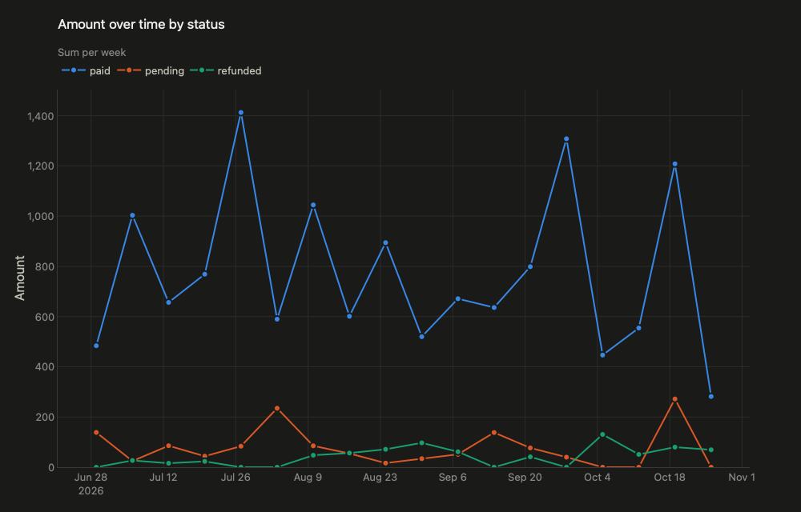

# fosset

a claude code plugin that charts your data. when a query result, metrics dump, benchmark or cost breakdown shows up in your session, claude hands it to fosset, a window pops up with the charts that actually make sense for it, and claude gets the same charts back. so you're both looking at the same thing.

it came from a pretty simple annoyance: claude spits out sql reports as json all the time (usage, metrics, that kind of stuff) and staring at raw json is not it.

## install

in your terminal:

```
claude plugin install fosset --marketplace borayil/fosset
```

or inside a claude code session:

```
/plugin marketplace add borayil/fosset
/plugin install fosset@fosset
```

you need [uv](https://docs.astral.sh/uv/) installed. no api key needed since claude is the llm here. the very first start downloads fosset's dependencies (about 20s, once), after that it starts instantly.

## use it

then just work like normal. when there's something worth charting, claude charts it. or ask it to, or run `/fosset:visualize path/to/file.json`. comparing options for a decision works too, claude lays them out as rows and charts them.

say you ask claude to chart `examples/orders.csv`. you get a window, you flip through the charts:



and along with pngs of the first 4 charts, claude gets the numbers behind every chart:

```
orders.csv: 400 rows, 5 columns
...
2. Amount over time by status [line x=created_at y=amount color=status]
  paid: 18 points, from 483.7 (2026-06-29) to 281.67 (2026-10-26), low 281.67 (2026-10-26), high 1,412.68 (2026-07-27)
  ...
3. Amount by status [bar x=status y=amount]
  3 bars, biggest first: paid 13.9K, pending 1,378.57, refunded 771.5. total 16K
```

so when it tells you paid orders are 13.9k of the 16k total, that's the real number and not a guess from the picture.

fosset picks the charts on its own first. if they miss what you asked about, claude asks for specific ones and those go first. it draws line, bar, scatter, histogram, kpi tiles and a table. for anything else, like a pie, a map or two y axes, claude can still write a script.

## where your data goes

fosset runs on your machine and the plugin doesn't call anything. what claude gets back, the numbers and the pngs, is part of your claude session like any other tool result.

## where it runs

built and tested on macos. over ssh or on a linux box with no display you get the numbers plus an html file you can open in a browser. windows and desktop linux are untested.

## in the window

* ← → flips through the charts
* s saves the current one as a png in whatever folder you ran it from
* esc closes it

it follows your mac's light or dark mode, and the colors are colorblind safe. numbers follow your mac's region too, so in turkey you get 1.464 and 2,5, in the us 1,464 and 2.5.

## how it picks charts

it reads the file, figures out what each column is (numbers, dates, categories, ids) and goes from there. dates plus numbers get line charts, categories get ranked bars, a single row of numbers gets big kpi tiles, and you always get the raw table at the end. the chart it thinks you want most shows up first.

numbers written out for people get read as numbers too, like `21.985.979 ₺`, `%44` or `$1,234.50`. dots between thousands only count where the decimal mark is a comma (your region, or the setting below), because otherwise `1.464` is just one and a bit.

there's also a constraint check that throws out any chart that doesn't fit the data, like a column that isn't there or a bar chart of ids. everything goes through it, claude's picks included, so a bad guess just gets dropped instead of breaking the window, and claude gets told why.

## speed

the whole point is that it's fast. on my m5 a normal report goes from command to chart in about half a second, and a 200k row file takes around 1.7s. the very first launch after installing takes a few seconds while macos warms up webkit, after that it's quick.

to keep it that way there are limits: 25 mb max in, and anything past 200k rows gets cut off.

## settings

everything lives in `~/.config/fosset/config.toml`, and every setting is optional:

```toml
[display]
numbers = "1.234,5"   # or "1,234.5". leave it out to follow your mac's region
```

you can also just tell claude ("always do turkish numbers") and it writes the file for you. `numbers` in the plugin's tool, or `--numbers` on the command line, wins over it for one run.

## without claude

fosset is a plain cli too. give it json, csv or xml, a file or whatever's on your clipboard, and voila, same window. no prompting, no picking axes, no waiting around.

```
uv tool install git+https://github.com/borayil/fosset
fosset report.json
pbpaste | fosset
```

a few more things it can do:

```
fosset report.json --png charts/              # also save every chart as a png
fosset report.json --png charts/ --headless   # just the pngs, no window
fosset report.json --html report.html         # a page you can open in any browser
fosset report.json --specs picks.json         # just your own picks, {charts, labels} like the llm sends
fosset report.json --numbers 1.234,5          # write numbers the turkish way this once
```

`--timing` prints how long each step took if you're curious.

### the cli's llm step

this is only for the cli, the plugin doesn't use it since claude already does that job. totally optional, the rules do a fine job on their own. but if you want smarter picks and better titles (in the language your columns are in), add this to the config:

```toml
[llm]
provider = "anthropic"
model = "claude-opus-5-5"
# api_key = "sk-ant-..."   # or just export ANTHROPIC_API_KEY
```

or point it at a local model, anything that speaks the openai chat api works (ollama, lm studio, mlx, llama.cpp):

```toml
[llm]
provider = "local"
url = "http://localhost:11434/v1"
model = "qwen3"
```

the window still opens right away with the rule picks. the llm gets asked in the background and its picks swap in when they land, the footer tells you what's going on. if it fails or you're offline you just keep the rule picks.

it only ever sees the column names, their types and 3 sample values per column, never your actual rows. answers get cached per column layout in `~/.cache/fosset/`, so running the same report again is instant and doesn't cost anything. `--no-llm` skips it for one run.

## dev

```
git clone https://github.com/borayil/fosset
cd fosset
uv sync
uv run pytest
uv run fosset examples/orders.csv
```
